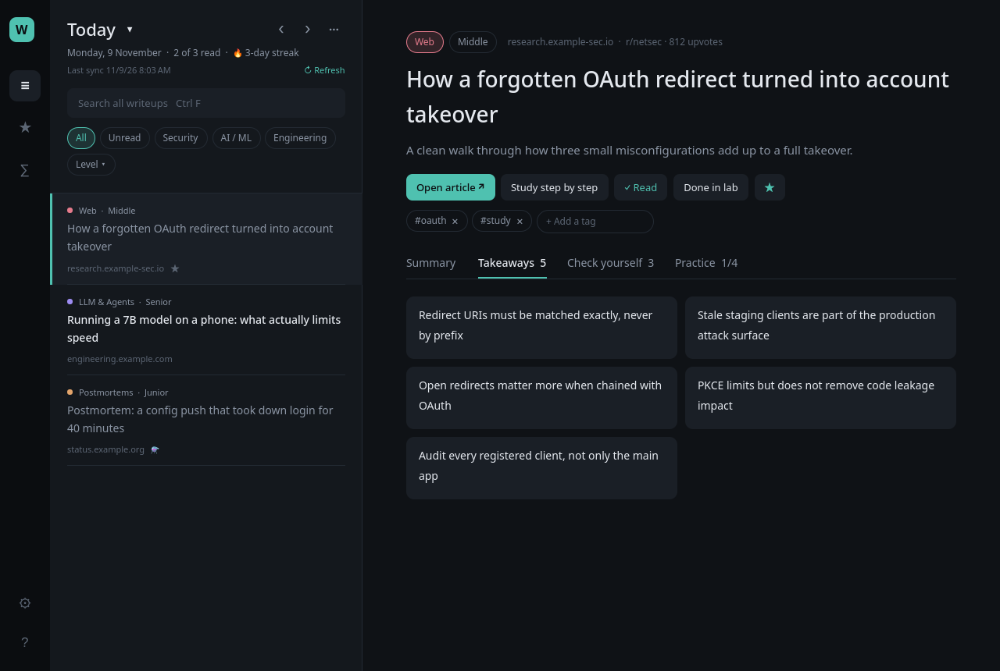
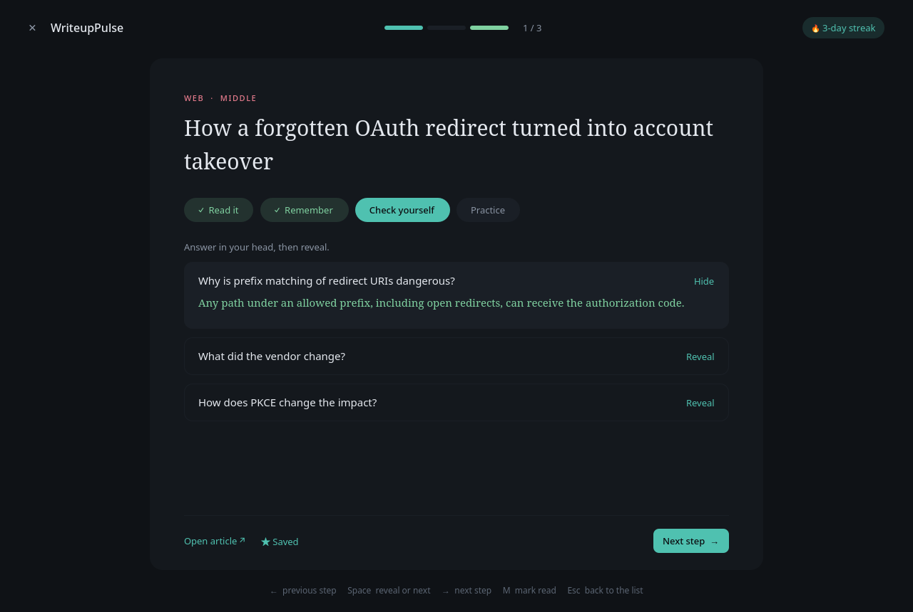

# WriteupPulse



Every morning WriteupPulse has Claude Code look through Hacker News, r/netsec,
r/programming, lobste.rs, GitHub Trending, and engineering blogs. It picks the
five most interesting fresh technical writeups (security research, CTF, AI,
engineering deep dives, postmortems), reads them, and summarizes each one. The
window shows today's picks and every earlier day.

The agent gets only web search and web fetch. It has no shell and no file
access, and it answers with JSON that WriteupPulse checks before saving.

## Install

Needs [Claude Code](https://claude.com/claude-code), signed in (`claude`).

```sh
bin/install
```

This builds the package, installs it with `makepkg -fsi`, and turns on the
daily timer. WriteupPulse then shows up in the app launcher (`Super + Space`).

## How it runs

- `writeuppulse.timer` starts `writeuppulse.service` every day at 08:00. If the
  machine was off then, it runs on the next boot. Turn it off and on with the
  switch in the window, or with `systemctl --user disable --now writeuppulse.timer`.
- **Refresh now** starts the same service, so a fetch keeps going after the
  window closes. A fetch takes a few minutes. Logs: `journalctl --user -u writeuppulse`.
- Digests are saved as `~/.local/share/writeuppulse/<date>.json` and `<date>.md`.

## Reading and learning

The day's writeups sit in a list on the left, each with its direction (Web, Pwn,
Reverse, Crypto, Cloud Security, Red Team, Blue Team, Malware, OSINT, LLM & Agents,
ML Engineering, Systems & Performance, Backend & Databases, DevOps & Infra,
Postmortems, Other) and level (Junior, Middle, Senior). The open one is on the
right, in four tabs: the summary, 5–8 takeaways, self-check questions with hidden
answers, and a "Try it yourself" checklist of practice ideas for a lab you control.

**Study step by step** (Enter) opens focus mode: one writeup at a time, through
read → remember → check yourself → practice, with the day's progress on top.



WriteupPulse is for understanding, not attacking: the agent is told never to write
code, commands, payloads, or exploits, and the app cuts out any code block that
slips through.

Mark writeups as read (M), done in a lab (B), or favorite (F), and tag them.
Filter the list by topic, level, or unread; search covers every saved day.
Settings (P) holds the language, the daily timer, and which directions the agent
searches, with stars for the ones it should pick more often. Export (E) saves the
day, or the week ending on it, as Markdown through the desktop's save dialog, with
your read marks, tags, and checked practice items. Progress lives in
`~/.local/share/writeuppulse/progress.json`; Statistics shows the streak and what
you read most.

## Install

Needs [Claude Code](https://claude.com/claude-code), signed in (`claude`).

```sh
bin/install
```

This builds the package, installs it with `makepkg -fsi`, and turns on the
daily timer. WriteupPulse then shows up in the app launcher (`Super + Space`).

## How it runs

- `writeuppulse.timer` starts `writeuppulse.service` every day at 08:00. If the
  machine was off then, it runs on the next boot. Turn it off and on with the
  switch in the window, or with `systemctl --user disable --now writeuppulse.timer`.
- **Refresh now** starts the same service, so a fetch keeps going after the
  window closes. A fetch takes a few minutes. Logs: `journalctl --user -u writeuppulse`.
- Digests are saved as `~/.local/share/writeuppulse/<date>.json` and `<date>.md`.

## Learning

Each writeup comes with its direction (Web, Pwn, Reverse, Crypto, Cloud Security,
Red Team, Blue Team, Malware, OSINT, LLM & Agents, ML Engineering, Systems &
Performance, Backend & Databases, DevOps & Infra, Postmortems, Other) and a level
(Junior, Middle, Senior). The deep view adds 5–8 takeaways, self-check questions
with hidden answers, and a "Try it yourself" checklist of practice ideas for a lab
you control. WriteupPulse is for understanding, not attacking: the agent is told
never to write code, commands, payloads, or exploits, and the app cuts out any
code block that slips through.

**Directions** (P) picks which directions the agent searches and stars the ones it
should pick more often; starred directions also come first in each day. **Export**
(E) saves the day, or the week ending on it, as Markdown through the desktop's save
dialog, with your read marks, tags, and checked practice items.

Mark writeups as read (M), done in a lab (B), or favorite (F), and tag favorites.
Filters narrow a day by direction, level, and read state; search covers every
saved day. Your progress lives in `~/.local/share/writeuppulse/progress.json`,
and Statistics shows the reading streak, counts, and directions you read most.

Other settings come from the environment: `WRITEUPPULSE_MODEL` (default `sonnet`),
`WRITEUPPULSE_CLAUDE` (path to `claude` if it isn't found), and
`WRITEUPPULSE_DATA` (the data directory).

## Commands

| Command | What it does |
| --- | --- |
| `writeuppulse` / `writeuppulse open` | Open the window |
| `writeuppulse fetch [--json]` | Run the agent now and save today's digest |
| `writeuppulse list [--json]` | List the saved days |
| `writeuppulse show [DATE] [--json]` | Print a day's digest |
| `writeuppulse export [DATE] [--week] [--output FILE]` | Export a day or week as Markdown with your progress |
| `writeuppulse skill install` | Install a Claude Code skill for reading digests |

## Shortcuts

| Key | Action |
| --- | --- |
| ↑ ↓ (K J) | Previous or next writeup |
| ← → | Older or newer day; in focus mode, previous or next step |
| 1 – 4 | Summary, takeaways, questions, practice |
| Enter | Study the writeup step by step |
| Space | In focus mode, reveal the next answer or go on |
| O | Open the article in the browser |
| M | Mark as read |
| B | Mark as done in a lab |
| F | Add to or remove from favorites |
| U | Show only unread |
| Ctrl+F or / | Search all saved writeups |
| S | Statistics |
| P | Settings and directions |
| E | Export the day or week as Markdown |
| R | Fetch today's writeups now |
| Esc | Back to the list |
| ? | Show or hide shortcuts |
| Q | Quit |

## Develop

```sh
bin/build    # build/writeuppulse
bin/test     # Qt Test, offscreen
```
